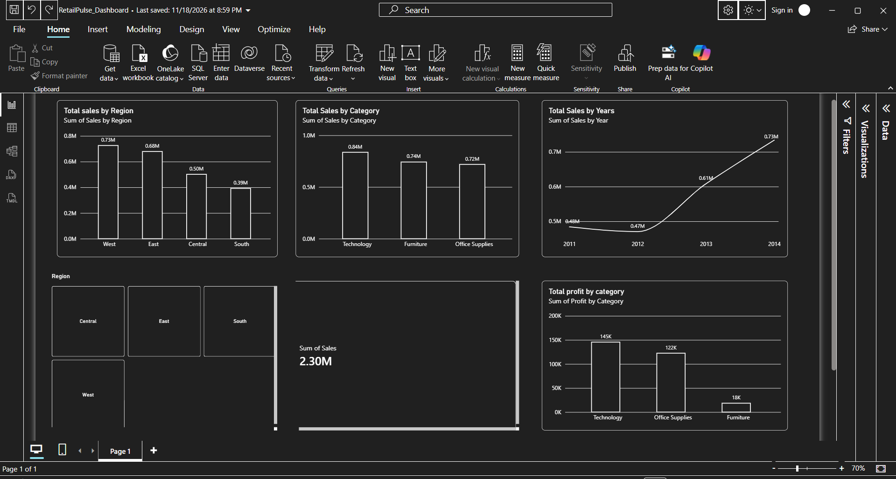
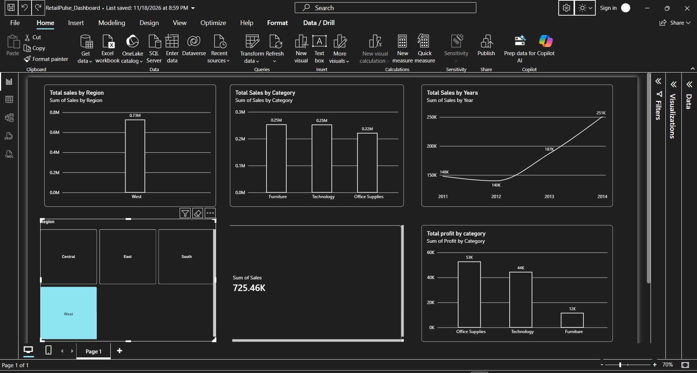
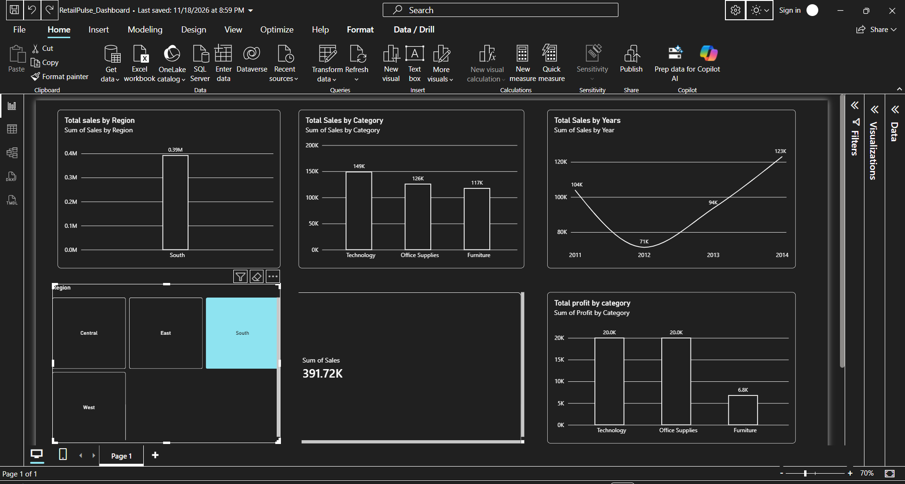
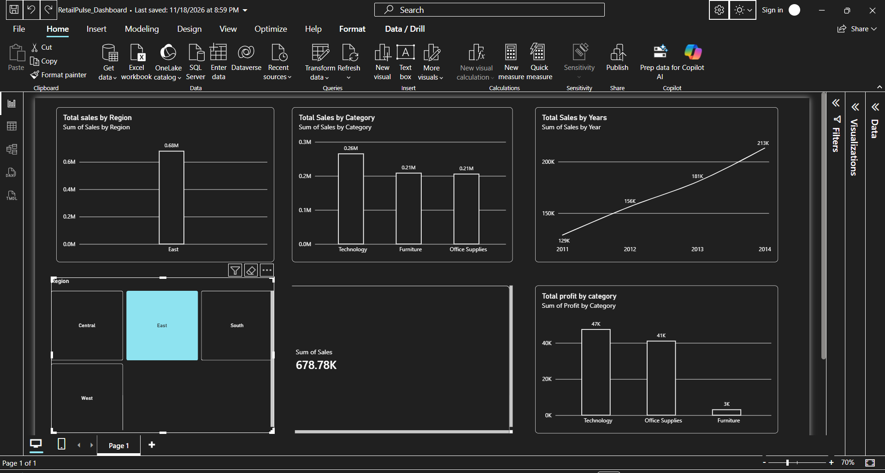
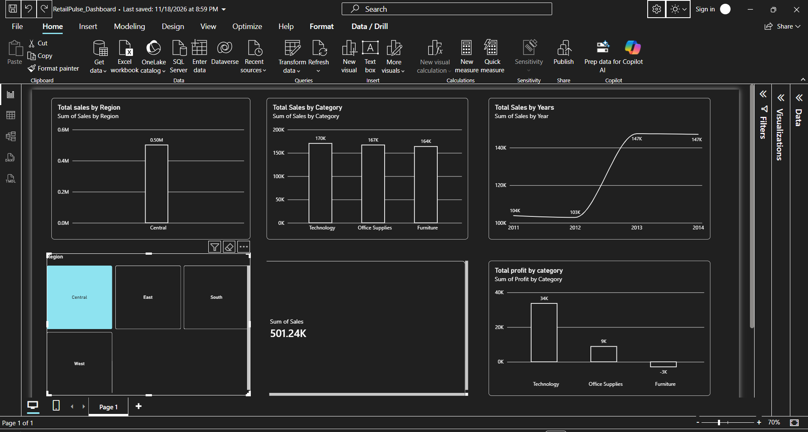

# RetailPulse Sales Dashboard

Sales performance dashboard built with Excel and Power BI on the Superstore dataset.

## Tools
Excel, Power BI

## Dashboard

The dashboard shows total sales by region, by category and by year, plus profit by category. A region slicer filters every visual.

## Key Findings
1. Total sales: 2.30M.
2. West is the top region (725K) and South the lowest (392K); East 679K, Central 501K.
3. Technology leads in both sales and profit.
4. Furniture sells well but earns the least profit, and shows a small loss in the Central region.
5. Sales grew from about 0.48M in 2011 to 0.73M in 2014.

## Filtered Views

## Files
- `RetailPulse_Dashboard.pbix`: Power BI dashboard file
